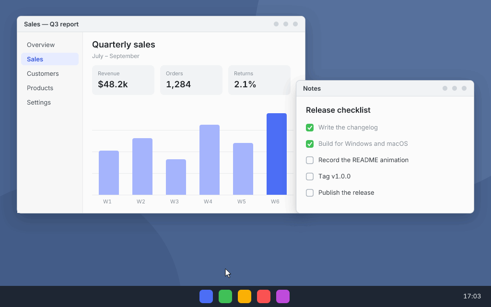
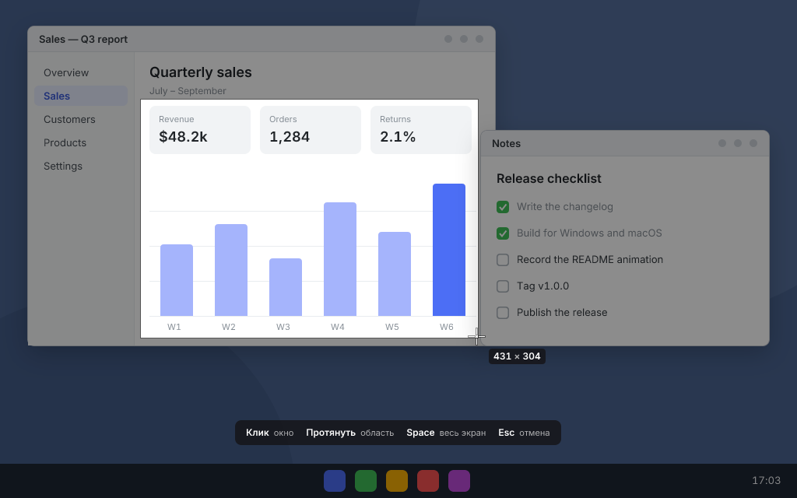
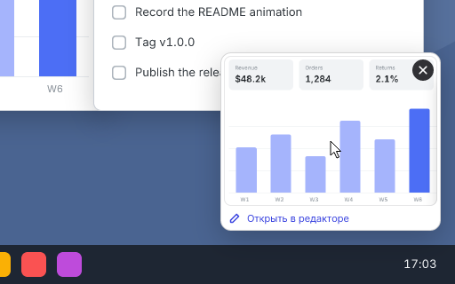
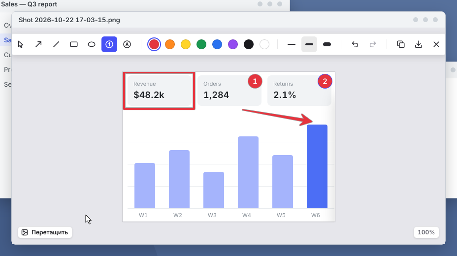
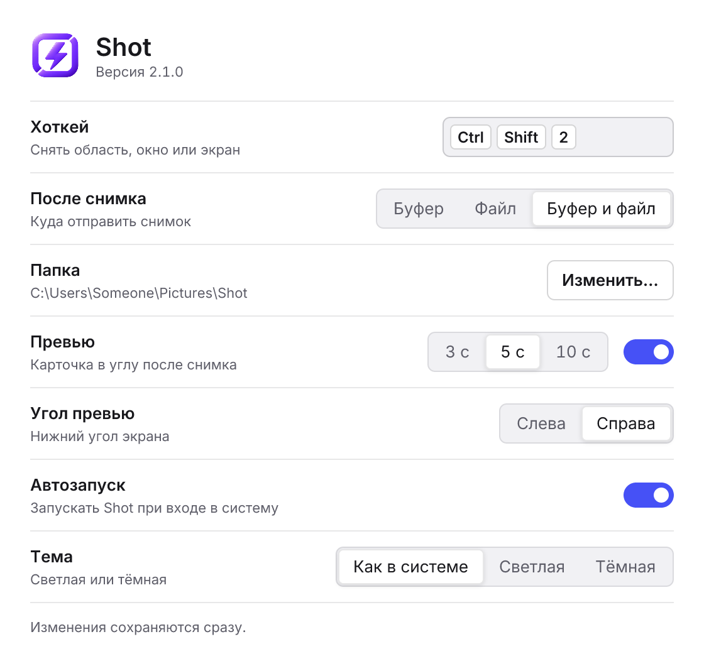

# Shot

A fast, frugal screenshot tool for Windows and macOS, with the same look and the same keys on
both. Press the hotkey and the screen freezes in 35 ms; pick a window or drag an area, and the
shot is in the clipboard 12 ms after you let go of the mouse. At rest Shot takes 2 MB of memory
and sleeps until the next hotkey.



| 35 ms | 2 MB | < 2 MB | 0 |
|:---:|:---:|:---:|:---:|
| hotkey to frozen screen | of memory at rest | the whole program on Windows | network requests; no timers or polling at rest |

- **Frozen screen.** Shot captures every monitor the moment you press the hotkey, so open menus
  and tooltips stay put while you choose what to keep.
- **Window, area or whole screen**, at full resolution on high-DPI and Retina displays, with
  monitors at different scales side by side.
- **Preview in the corner** that never takes the focus from the window you work in.
- **An editor for quick marks**: arrows, lines, rectangles, ellipses and numbered steps. Every
  mark stays an object you can move, resize, recolor or delete. Drag the result straight into a
  chat or a folder.
- **Private.** No network access, no telemetry, no account.

The interface is in Russian for now.

## Speed and memory

Every step of a capture has a time and memory budget, and a change that breaks one is a bug.
Measured on release builds on a Ryzen 7 7800X3D with Windows 11 and two monitors, 2560×1440 at
100% and a portrait 1440×2560 at 125%; medians, or the range over runs:

| Step | Shot | Budget |
|---|---:|---:|
| Launch → hotkey works | 42–49 ms | 100 ms |
| Hotkey → frozen screen on the monitor under the pointer | 35 ms | 50 ms |
| Mouse released → shot in the clipboard | 12–13 ms | 30 ms |
| Mouse released → preview on screen | 15–19 ms | 50 ms |
| Click on the preview → editor on screen | 23–43 ms | 100 ms |
| One frame while dragging an area on a 4K monitor | 0.1–0.2 ms | 8 ms |
| One frame while drawing in the editor, 4K | 0.3–1 ms | 8 ms |
| Memory at rest (Task Manager's *Memory* column) | 2 MB | 10 MB |
| Memory 5 s after the editor closes | +0.4 MB | +5 MB |
| Program size | under 2 MB | 5 MB |

On a MacBook Air M3 Shot is ready 70 ms after launch, takes 9 MB at rest (Activity Monitor's
*Memory*), puts a whole Retina screen in the clipboard in 15–19 ms and opens the editor in
40–60 ms. The first launch after an install is slower, once, while macOS checks the app.

While the overlay is open, Shot holds a frozen frame and a canvas for each monitor: about 60 MB
for the two monitors above. It gives them back to the system as the overlay closes.

### Where the speed comes from

- **The capture comes before the interface.** The hotkey grabs the monitor under the pointer
  first and shows its overlay at once; the other monitors follow.
- **Everything is ready before the hotkey.** The overlay and preview windows are made at start
  and kept hidden. The hotkey only shows them.
- **Only what changes is redrawn.** Dragging an area on a 4K monitor redraws the strips around
  the frame, 0.07 of 8.3 megapixels a step. The screen is dimmed on the fly with SIMD as it is
  copied, so there is no third screen-sized buffer.
- **The clipboard first, the disk in the background.** The PNG is written on another thread
  after the shot is already in the clipboard.
- **Memory goes back.** Screen-sized buffers are freed as soon as the overlay or the editor
  closes. On Windows Shot does not keep its own copy of the clipboard image (14 MB at 1440p,
  33 MB at 4K), and the folder picker runs in a separate short-lived process, because the system
  dialog leaves about 5 MB of shell libraries behind in any process that shows it.
- **Asleep at rest.** No timers and no polling: one thread waits on a single system call for the
  hotkey, a click on the tray icon or a change to the settings file.
- **A small stack.** Rust, Win32 and AppKit called directly, and
  [tiny-skia](https://github.com/linebender/tiny-skia) for every pixel Shot draws. No web view,
  no GPU context, no runtime, no network code.

## Install

Download the latest build from [Releases](https://github.com/poznik/shot/releases). The builds
are not signed by Microsoft or Apple, so each system warns you once before the first start.

### Windows 10 22H2 or 11

1. Download `Shot-<version>-windows-x64-setup.exe` and run it. It needs no administrator rights:
   Shot goes to `%LOCALAPPDATA%\Programs\Shot`, with a Start menu shortcut and an entry in
   **Settings → Apps**.
2. If SmartScreen says "Windows protected your PC", click **More info**, then **Run anyway**.
3. At the end the installer offers to start Shot. It lives in the notification area; the first
   start offers to start Shot at login.

To update, run the installer of a newer version: it closes Shot and keeps your settings and
start at login, also over the single-file Shot 1.0 in that folder.

### macOS 14 or later

1. Download `Shot-<version>-macos.dmg`, open it and drag **Shot** onto **Applications**.
2. Open Shot. macOS says it cannot verify the app: click **Done**, open **System Settings →
   Privacy & Security**, scroll down and click **Open Anyway** next to Shot.
3. Shot needs the **Screen Recording** permission: its window has a button that opens the right
   page of System Settings. Turn Shot on there.
4. Shot lives in the menu bar and has no Dock icon.

## Use

Press **Ctrl+Shift+2** on Windows or **⇧⌘2** on macOS. The screen freezes and dims; the window
under the pointer lights up, and the size of the area follows the pointer.



| Do | To |
|---|---|
| Click a highlighted window | Capture the window |
| Drag | Capture an area |
| `Space` | Capture each monitor to its own file; the clipboard gets the one under the cursor |
| `Esc` or right click | Cancel |

The shot goes to the clipboard and to `Pictures/Shot` as `Shot 2026-10-22 17-03-15.png`, and a
preview shows in a bottom corner for a few seconds. Pointing at it keeps it on screen; a click
opens the editor.



### Editor



`Ctrl` is `Cmd` on macOS.

| Key | Action |
|---|---|
| `A` `L` `R` `O` `N` | Arrow, line, rectangle, ellipse, counter; `N` again switches 1, 2, 3 and A, B, C |
| `V` | Select: move, resize with the handles, `Del` to delete |
| `Ctrl+Z`, `Ctrl+Shift+Z` | Undo, redo (also `Ctrl+Y` on Windows) |
| `Ctrl+C` | Copy the result |
| `Ctrl+S` | Save over the same file and copy |
| `Enter` | Save and close |
| `Esc` | Close; with unsaved edits, Shot asks first |
| `Ctrl` + wheel, `Ctrl+0`, `Ctrl+1` | Zoom, fit, 100% |

Drag the **Перетащить** (Drag) button in the bottom left corner like a file: drop it on a folder
to get a copy of the shot, or in a chat to send it. Dragging saves nothing.

### Settings

<picture>
  <source media="(prefers-color-scheme: dark)" srcset="media/settings-dark.png">
  
</picture>

Open **Настройки…** (Settings) from the tray or menu bar icon to change the hotkey, where shots go
(clipboard, file or both), the folder, the preview and its corner (bottom left or bottom right),
start at login and the theme. Starting Shot again while it runs opens the same window. The
settings are a plain file: `%APPDATA%\Shot\settings.toml` on Windows,
`~/Library/Application Support/Shot/settings.toml` on macOS.

## Uninstall

- **Windows:** **Settings → Apps → Shot → Uninstall**. It quits Shot and removes start at login;
  your settings in `%APPDATA%\Shot` and shots in `Pictures\Shot` stay.
- **Windows, the single file of 1.0:** turn off **Автозапуск** (start at login) in the tray menu,
  quit Shot and delete the file. Its settings are in `%APPDATA%\Shot`.
- **macOS:** turn off **Автозапуск** in the menu bar menu, quit Shot and move it to the Trash. Its
  settings are in `~/Library/Application Support/Shot`.

## Build from source

Shot is written in Rust (stable, edition 2024) and draws its own interface with
[tiny-skia](https://github.com/linebender/tiny-skia); it uses no web view and no GPU context.

```sh
cargo build --release
```

That gives `target/release/shot.exe` on Windows and `target/release/shot` on macOS. The Windows
installer comes from `python tools/installer-win.py`, which needs
[Inno Setup 6](https://jrsoftware.org/isinfo.php). To make `Shot.app` and its disk image on a
Mac, run `tools/bundle-mac.sh`; add `--universal` for Apple silicon and Intel in one app (needs
both Rust targets). macOS ties the Screen Recording permission to the app's
signature: sign your builds with one certificate from `tools/mac-sign-cert.sh` to keep the
permission across rebuilds.

The pictures in this README are drawn by Shot's own code on a made-up desktop:
`cargo run -p shot-core --release --example demo` writes them to `target/demo`. The forms and
behavior of every window, and the design tokens the code draws with, are in
[docs/design](docs/design).

## License

[MIT](LICENSE)
