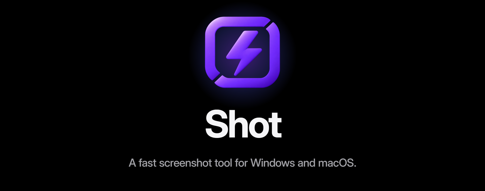

<p align="center"></p>

<p align="center"><b>Русский</b> · <a href="README.en.md">English</a></p>

Быстрый и экономный инструмент для скриншотов на Windows и macOS: на обеих системах он выглядит
одинаково и слушается одних и тех же клавиш. Нажмите горячую клавишу — экран замрёт за 35 мс;
выберите окно или протяните область, и через 12 мс после того, как вы отпустите мышь, снимок уже
в буфере обмена. В покое Shot занимает 2 МБ памяти и спит до следующего нажатия.

https://github.com/user-attachments/assets/39601a47-2756-40da-a265-687b62e4b51f

<p align="center"><sub>Ролик о Shot на 23 секунды, подписи на английском. Включите звук.</sub></p>

| 35 мс | 2 МБ | < 2 МБ | 0 |
|:---:|:---:|:---:|:---:|
| от горячей клавиши до замершего экрана | памяти в покое | вся программа на Windows | сетевых запросов; в покое ни таймеров, ни опроса |

- **Замерший экран.** Shot снимает все мониторы в момент нажатия, поэтому открытые меню и
  подсказки остаются на месте, пока вы выбираете, что сохранить.
- **Окно, область или весь экран** в полном разрешении на экранах высокой чёткости и Retina,
  в том числе когда рядом стоят мониторы с разным масштабом.
- **Превью в углу**, которое никогда не забирает фокус у окна, в котором вы работаете.
- **Редактор для быстрых пометок**: стрелки, линии, прямоугольники, эллипсы и нумерованные шаги.
  Каждая пометка остаётся объектом: её можно сдвинуть, изменить размер, перекрасить или удалить.
  Результат можно перетащить прямо в чат или в папку.
- **Приватность.** Ни доступа к сети, ни телеметрии, ни учётной записи.

Интерфейс пока только на русском.

## Скорость и память

У каждого шага съёмки есть бюджет по времени и памяти, и изменение, которое его нарушает, — баг.
Замеры на релизных сборках: Ryzen 7 7800X3D, Windows 11 и два монитора, 2560×1440 при 100 % и
вертикальный 1440×2560 при 125 %; медианы или разброс по запускам:

| Шаг | Shot | Бюджет |
|---|---:|---:|
| Запуск → горячая клавиша работает | 42–49 мс | 100 мс |
| Горячая клавиша → замерший экран на мониторе под курсором | 35 мс | 50 мс |
| Мышь отпущена → снимок в буфере обмена | 12–13 мс | 30 мс |
| Мышь отпущена → превью на экране | 15–19 мс | 50 мс |
| Клик по превью → редактор на экране | 23–43 мс | 100 мс |
| Один кадр, пока тянете область на 4K-мониторе | 0,1–0,2 мс | 8 мс |
| Один кадр, пока рисуете в редакторе, 4K | 0,3–1 мс | 8 мс |
| Память в покое (столбец *Память* в Диспетчере задач) | 2 МБ | 10 МБ |
| Память через 5 с после закрытия редактора | +0,4 МБ | +5 МБ |
| Размер программы | меньше 2 МБ | 5 МБ |

На MacBook Air M3 Shot готов через 70 мс после запуска, занимает 9 МБ в покое (*Память* в
Мониторинге системы), кладёт весь экран Retina в буфер обмена за 15–19 мс и открывает редактор
за 40–60 мс. Первый запуск после установки один раз дольше: macOS проверяет приложение.

Пока открыт оверлей, Shot держит замороженный кадр и холст для каждого монитора: около 60 МБ для
двух мониторов выше. Он отдаёт их системе, как только оверлей закрывается.

### Откуда скорость

- **Сначала снимок, потом интерфейс.** По горячей клавише Shot сначала снимает монитор под
  курсором и сразу показывает его оверлей; остальные мониторы — следом.
- **Всё готово до нажатия.** Окна оверлея и превью создаются при запуске и ждут скрытыми.
  Горячая клавиша их только показывает.
- **Перерисовывается только то, что изменилось.** Когда вы тянете область на 4K-мониторе,
  перерисовываются полосы вокруг рамки: 0,07 из 8,3 мегапикселя за шаг. Экран затемняется на лету
  SIMD-инструкциями, пока копируется, поэтому третьего буфера размером с экран нет.
- **Сначала буфер обмена, диск — в фоне.** PNG пишется в другом потоке, когда снимок уже в
  буфере обмена.
- **Память возвращается.** Буферы размером с экран освобождаются, как только закрывается оверлей
  или редактор. На Windows Shot не держит свою копию картинки из буфера обмена (14 МБ при 1440p,
  33 МБ при 4K), а выбор папки работает в отдельном короткоживущем процессе: системный диалог
  оставляет около 5 МБ библиотек оболочки в любом процессе, который его показал.
- **В покое спит.** Ни таймеров, ни опроса: один поток ждёт в одном системном вызове горячую
  клавишу, клик по значку в трее или изменение файла настроек.
- **Небольшой стек.** Rust, прямые вызовы Win32 и AppKit и
  [tiny-skia](https://github.com/linebender/tiny-skia) для каждого пикселя, который рисует Shot.
  Ни веб-вью, ни GPU-контекста, ни рантайма, ни сетевого кода.

## Установка

Скачайте последнюю сборку со страницы [Releases](https://github.com/poznik/shot/releases).
Сборки не подписаны Microsoft и Apple, поэтому каждая система один раз предупредит перед первым
запуском.

### Windows 10 22H2 или 11

1. Скачайте `Shot-<version>-windows-x64-setup.exe` и запустите. Права администратора не нужны:
   Shot ставится в `%LOCALAPPDATA%\Programs\Shot`, с ярлыком в меню «Пуск» и записью в
   **Параметры → Приложения**.
2. Если SmartScreen пишет «Система Windows защитила ваш компьютер», нажмите **Подробнее**, затем
   **Выполнить в любом случае**.
3. В конце установщик предложит запустить Shot. Он живёт в области уведомлений; при первом
   запуске Shot предложит запускаться при входе в систему.

Чтобы обновиться, запустите установщик новой версии: он закроет Shot и сохранит настройки и
автозапуск, в том числе поверх однофайлового Shot 1.0 в этой папке.

### macOS 14 или новее

1. Скачайте `Shot-<version>-macos.dmg`, откройте его и перетащите **Shot** в **Программы**.
2. Откройте Shot. macOS скажет, что не может проверить приложение: нажмите **Готово**, откройте
   **Системные настройки → Конфиденциальность и безопасность**, прокрутите вниз и нажмите
   **Всё равно открыть** рядом с Shot.
3. Shot нужно разрешение **Запись экрана**: в его окне есть кнопка, которая открывает нужную
   страницу Системных настроек. Включите там Shot.
4. Shot живёт в строке меню, значка в Dock у него нет.

## Как пользоваться


Нажмите **Ctrl+Shift+2** на Windows или **⇧⌘2** на macOS. Экран замирает и темнеет; окно под
курсором подсвечивается, а размер области показан рядом с курсором.


| Действие | Что получится |
|---|---|
| Клик по подсвеченному окну | Снимок окна |
| Протянуть | Снимок области |
| `Space` | Каждый монитор в свой файл; в буфер обмена — тот, что под курсором |
| `Esc` или правый клик | Отмена |

Снимок попадает в буфер обмена и в `Pictures/Shot` как `Shot 2026-10-22 17-03-15.png`, а в
нижнем углу на несколько секунд появляется превью. Пока курсор на нём, оно не исчезает; клик
открывает редактор.


### Редактор


На macOS вместо `Ctrl` — `Cmd`.

| Клавиша | Действие |
|---|---|
| `A` `L` `R` `O` `N` | Стрелка, линия, прямоугольник, эллипс, счётчик; `N` ещё раз переключает 1, 2, 3 и A, B, C |
| `V` | Выделение: двигать, менять размер за маркеры, `Del` — удалить |
| `Ctrl+Z`, `Ctrl+Shift+Z` | Отменить, повторить (на Windows ещё `Ctrl+Y`) |
| `Ctrl+C` | Скопировать результат |
| `Ctrl+S` | Сохранить в тот же файл и скопировать |
| `Enter` | Сохранить и закрыть |
| `Esc` | Закрыть; если есть несохранённые правки, Shot сначала спросит |
| `Ctrl` + колесо, `Ctrl+0`, `Ctrl+1` | Масштаб, вписать в окно, 100 % |

Кнопку **Перетащить** в левом нижнем углу можно тащить, как файл: бросьте её на папку, чтобы
получить копию снимка, или в чат, чтобы его отправить. Перетаскивание ничего не сохраняет.

### Настройки

<picture>
  <source media="(prefers-color-scheme: dark)" srcset="media/settings-dark.png">
  
</picture>

Откройте **Настройки…** из значка в трее или в строке меню, чтобы поменять горячую клавишу, куда
идут снимки (буфер обмена, файл или оба), папку, превью и его угол (левый или правый нижний),
автозапуск и тему. Если запустить Shot ещё раз, пока он работает, откроется это же окно.
Настройки — обычный файл: `%APPDATA%\Shot\settings.toml` на Windows,
`~/Library/Application Support/Shot/settings.toml` на macOS.

## Удаление

- **Windows:** **Параметры → Приложения → Shot → Удалить**. Это закроет Shot и уберёт
  автозапуск; настройки в `%APPDATA%\Shot` и снимки в `Pictures\Shot` останутся.
- **Windows, однофайловый Shot 1.0:** выключите **Автозапуск** в меню значка в трее, закройте
  Shot и удалите файл. Его настройки лежат в `%APPDATA%\Shot`.
- **macOS:** выключите **Автозапуск** в меню значка в строке меню, закройте Shot и перенесите его
  в Корзину. Его настройки лежат в `~/Library/Application Support/Shot`.

## Сборка из исходников

Shot написан на Rust (stable, edition 2024) и сам рисует свой интерфейс с помощью
[tiny-skia](https://github.com/linebender/tiny-skia); веб-вью и GPU-контекст он не использует.

```sh
cargo build --release
```

Получится `target/release/shot.exe` на Windows и `target/release/shot` на macOS. Установщик для
Windows собирает `python tools/installer-win.py`, ему нужен
[Inno Setup 6](https://jrsoftware.org/isinfo.php). Чтобы собрать `Shot.app` и образ диска на
Mac, запустите `tools/bundle-mac.sh`; с `--universal` получится одно приложение для Apple silicon
и Intel (нужны обе цели Rust). macOS привязывает разрешение «Запись экрана» к подписи
приложения: подписывайте свои сборки одним сертификатом из `tools/mac-sign-cert.sh`, чтобы
разрешение сохранялось между пересборками.

Картинки в этом README нарисованы собственным кодом Shot на выдуманном рабочем столе:
`cargo run -p shot-core --release --example demo` пишет их в `target/demo`. Формы и поведение
каждого окна и токены дизайна, которыми рисует код, описаны в [docs/design](docs/design).

## Лицензия

[MIT](LICENSE)
